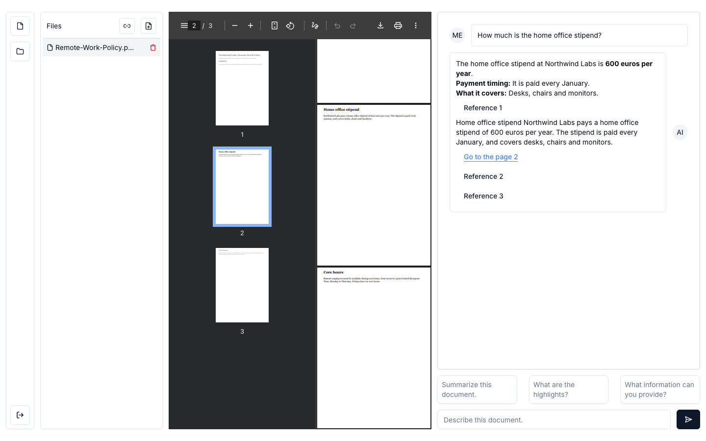
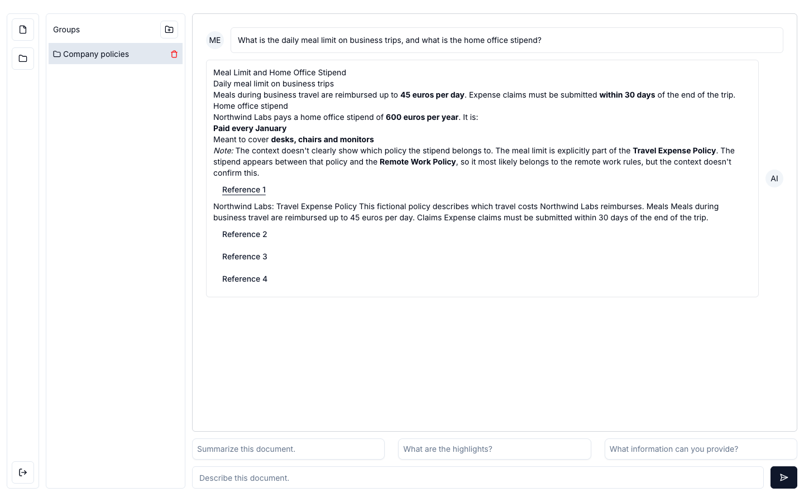
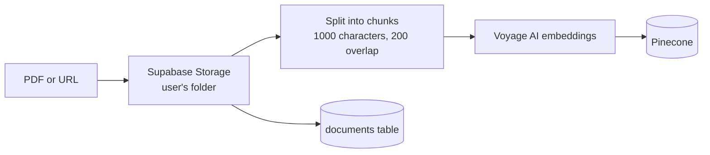
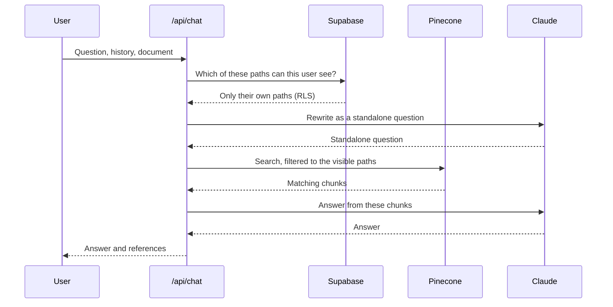

# Chat AI

[](https://github.com/turalowski/chat-ai/actions/workflows/ci.yml)
[](LICENSE)

Ask questions about your PDFs and web pages, and get answers grounded in their content, with references back to the source pages.



## Features

- **Chat with documents:** upload a PDF and ask questions, including follow-ups that depend on the conversation.
- **Web pages as documents:** enter a URL and the page is converted to a PDF and indexed.
- **Document groups:** ask one question across up to three documents.
- **References:** each answer lists the passages it used, and a link jumps to that page in the PDF preview.
- **Private by default:** each user can only reach their own files and documents.



The sample documents in these screenshots are fictional.

## Tech stack

| Area | Technology |
| --- | --- |
| App | Next.js 14 (App Router, server actions), TypeScript, Tailwind CSS, Radix UI |
| Answers | Claude Opus 5.5 through the Anthropic SDK |
| Retrieval | LangChain, Pinecone, Voyage AI embeddings |
| Auth, database, files | Supabase (Postgres with row level security, Storage) |
| Web page conversion | Puppeteer with headless Chromium |
| Quality | GitHub Actions, ESLint, RLS tests with `node:test` |

## How it works

Adding a document:



Asking a question:



## Getting started

```bash
npm install
npm run db:start                 # Supabase in Docker, no account needed
cp .env.example .env.local
npx supabase@2.122.0 status      # shows the local URL and anon key
```

Fill in `.env.local`, then run `npm run dev`. You need Docker, Node.js 20, Anthropic and Voyage AI API keys, and a Pinecone index. See [SETUP.md](SETUP.md) for the details, and for using a hosted Supabase project.

## Testing

CI runs lint, typecheck and a production build on every push and pull request. It also starts Supabase and runs [the RLS tests](tests/rls.test.mjs), which try to break the access rules with two users and an anonymous client: reading, deleting and claiming another user's files and rows.

```bash
npm run test:rls
```

## Known limitations

- **Before hosting a public demo:** there's no rate limiting, and packages need upgrading, including Next.js 14.
- **Web page conversion:** Chromium does its own DNS lookups, so URL checks don't fully stop DNS rebinding, and WebSocket connections aren't intercepted. Production use should isolate the renderer.
- **Ingestion runs inside the request:** a failure partway can leave a file with no database row, and large PDFs are slow.
- **Answers aren't streamed,** and the whole chat history is sent with each question.

## License

[MIT](LICENSE)
